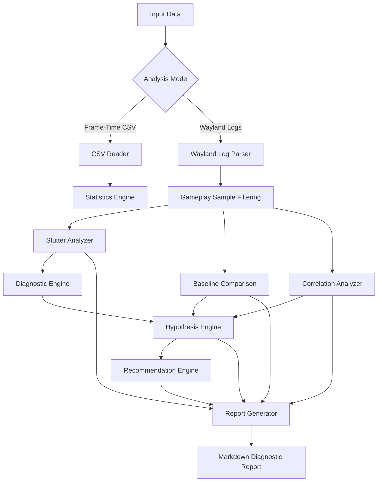

# 🎮 DroidDeck Graphics Profiler

<div align="center">

### C++17-Based Graphics Performance & Telemetry Analyzer

A modular performance-analysis tool for investigating frame-time instability, stuttering, and graphics presentation behavior in Android-based PC game emulation using DroidDeck.

Analyze Wayland/Gamescope telemetry, detect performance anomalies, compare gameplay conditions, investigate potential bottlenecks, and generate automated diagnostic reports.


</div>

---

# 📌 Project Overview

DroidDeck Graphics Profiler is a C++17-based performance-analysis tool developed alongside an investigation of stuttering and frame-time instability in Android-based PC game emulation.

The project analyzes frame-time measurements and Wayland/Gamescope telemetry to identify performance anomalies and investigate potential graphics presentation bottlenecks.

Unlike a conventional FPS monitoring tool, DroidDeck Graphics Profiler implements a diagnostic pipeline that combines telemetry parsing, statistical analysis, correlation analysis, baseline comparisons, hypothesis generation, and automated reporting.

The project demonstrates a modular systems-programming workflow involving:

- 📊 Frame-Time Analysis
- 🎮 Wayland/Gamescope Telemetry Parsing
- ⚡ Stutter and Anomaly Detection
- 📈 Statistical Baseline Comparison
- 🔍 Pearson Correlation Analysis
- 🧠 Evidence-Based Diagnostic Hypotheses
- 🛠 Investigation Recommendations
- 📄 Automated Markdown Reporting
- 🧪 Automated C++ Testing

---

# ✨ Features

- 📊 CSV-based frame-time analysis
- ⚡ Configurable stutter detection threshold
- 🎮 Wayland/Gamescope log parsing
- 🔍 Timestamp-based telemetry correlation
- 🖥 Presentation-surface lifecycle tracking
- 🚨 FPS degradation and timing anomaly detection
- 📈 Critical-FPS versus higher-FPS baseline comparison
- 📉 Pearson correlation analysis
- 🧠 Automated diagnostic hypothesis generation
- 🎯 Heuristic evidence scoring and confidence classification
- 🛠 Investigation recommendations and validation experiments
- 📄 Automated Markdown diagnostic report generation
- 🧪 10 independent CTest test suites
- 🧩 Modular C++17 architecture

---

# 🛠 Tech Stack

| Category | Technologies |
|---|---|
| Programming Language | C++17 |
| Build System | CMake |
| Build Tool | Ninja |
| Compiler | GCC / MSYS2 |
| Debugging | GDB |
| Graphics Telemetry | Wayland / Gamescope |
| Data Processing | CSV Parsing, Statistical Analysis |
| Correlation | Pearson Correlation |
| Testing | CTest |
| Development | Visual Studio Code, Git, GitHub |

---

# 📂 Project Structure

```text
droiddeck-graphics-profiler/
│
├── CMakeLists.txt
├── README.md
│
├── data/
│   ├── frame_times.csv
│   ├── wayland.log
│   └── droiddeck_wayland_10s_summary.csv
│
├── docs/
│   └── architecture.md
│
├── include/
│   ├── csv_reader.hpp
│   ├── statistics.hpp
│   ├── wayland_log_parser.h
│   ├── wayland_parser.h
│   ├── wayland_sample.h
│   ├── stutter_analyzer.hpp
│   ├── diagnostic_engine.hpp
│   ├── baseline_comparison.hpp
│   ├── correlation_analyzer.hpp
│   ├── hypothesis_engine.hpp
│   ├── recommendation_engine.hpp
│   └── report_generator.hpp
│
├── src/
│   ├── main.cpp
│   ├── csv_reader.cpp
│   ├── statistics.cpp
│   ├── stutter_analyzer.cpp
│   ├── diagnostic_engine.cpp
│   ├── baseline_comparison.cpp
│   ├── correlation_analyzer.cpp
│   ├── hypothesis_engine.cpp
│   ├── recommendation_engine.cpp
│   └── report_generator.cpp
│
├── tests/
│   ├── statistics_tests.cpp
│   ├── wayland_parser_test.cpp
│   ├── wayland_log_parser_test.cpp
│   ├── stutter_analyzer_tests.cpp
│   ├── diagnostic_engine_tests.cpp
│   ├── baseline_comparison_tests.cpp
│   ├── correlation_analyzer_tests.cpp
│   ├── hypothesis_engine_tests.cpp
│   ├── recommendation_engine_tests.cpp
│   └── report_generator_tests.cpp
│
└── reports/
    ├── day1_frame_time_analysis.md
    ├── day2_wayland_parser.md
    ├── day3_bottleneck_correlation.md
    ├── day4_anomaly_investigation.md
    ├── day5_diagnostic_engine_report.md
    ├── day6_robustness_validation.md
    ├── day7_diagnostic_reasoning_report.md
    └── wayland_diagnostic_report.md
```

---

# 🏗 System Architecture

DroidDeck Graphics Profiler uses a modular architecture that separates data ingestion, parsing, performance analysis, diagnostic reasoning, and report generation.

### High-Level Architecture



---

# ⚙️ Core Modules

### 1. Frame-Time Analyzer

Calculates fundamental performance statistics from CSV-based frame-time measurements.

- Average frame time
- Maximum frame time
- Estimated average FPS
- Configurable stutter threshold
- Invalid input validation

### 2. Wayland / Gamescope Telemetry Parser

Processes graphics presentation telemetry and extracts structured performance information.

- Parses statistics and performance records
- Correlates records using timestamps
- Tracks presentation-surface lifecycle events
- Extracts rendering and presentation timing measurements
- Handles incomplete and malformed records

### 3. Stutter Analyzer

Identifies performance anomalies in gameplay telemetry.

- Detects critically low FPS
- Identifies timing anomalies
- Classifies events by severity
- Filters inactive and non-gameplay samples
- Associates detected events with their timing measurements

### 4. Baseline Comparison Engine

Compares critically degraded gameplay intervals against higher-FPS intervals.

Analyzed metrics include:

- Average FPS
- Render Scene timing
- Acquire timing
- Present timing
- Fence Wait timing
- Release timing
- Held-frame ratio

### 5. Correlation Analyzer

Uses Pearson correlation coefficients to investigate relationships between FPS and graphics telemetry.

Analyzed relationships:

- FPS vs GPU frames from games
- FPS vs frames on screen
- FPS vs held-frame ratio
- FPS vs GPU release waits

Undefined correlations are handled when observations are insufficient or the data has zero variance.

### 6. Diagnostic Hypothesis Engine

Generates evidence-based hypotheses to investigate potential performance bottlenecks.

Investigated categories:

- Frame Production Degradation
- Release Timing Bottleneck
- Presentation Lifecycle Interference
- Render Bottleneck
- Synchronization Bottleneck

Each hypothesis contains supporting evidence, contradictory evidence, a heuristic evidence score, and a confidence classification.

### 7. Recommendation Engine

Converts diagnostic hypotheses into actionable investigation plans.

Each recommendation includes:

- Related hypothesis
- Investigation priority
- Rationale
- Investigation steps
- Validation experiments

### 8. Automated Report Generator

Generates a comprehensive Markdown report containing:

- Executive summary
- Performance overview
- FPS group comparison
- Baseline comparison
- Correlation analysis
- Diagnostic hypotheses
- Investigation recommendations
- Detected stutter events
- Limitations and interpretation

---

# 📊 Performance Analysis

The analyzer was evaluated using a supplied Wayland/Gamescope telemetry session.

### Observed Results

| Metric | Result |
|---|---:|
| Wayland Samples Loaded | 88 |
| Gameplay Samples Analyzed | 85 |
| Stutter Events Detected | 67 |
| FPS Degradation Events | 7 |
| Timing Anomaly Events | 61 |
| Combined Anomaly Events | 1 |

### FPS Group Comparison

| FPS Group | Samples | Average FPS |
|---|---:|---:|
| Critical (<10 FPS) | 5 | 4.04 |
| Low (10–<15 FPS) | 2 | 13.05 |
| Intermediate (15–<30 FPS) | 22 | 24.74 |
| Higher (≥30 FPS) | 56 | 36.36 |

### Baseline Analysis

The critical-FPS group averaged 4.04 FPS, compared with 36.36 FPS in the higher-FPS group.

This represents an 88.89% lower average FPS in the critical group.

However, aggregate rendering, acquire, present, fence-wait, and release averages did not independently establish a specific bottleneck.

### Diagnostic Findings

The analysis generated five diagnostic hypotheses.

Presentation Lifecycle Interference received a medium heuristic confidence classification, while the other four hypotheses received low confidence.

The results suggest further investigation of presentation lifecycle behavior and independent frame-production measurements.

**Important:** These findings are diagnostic observations, not proof of a confirmed root cause.

---

# 📄 Automated Diagnostic Reports

The project generates a Markdown report automatically when running the Wayland analysis mode.

Generated report:

```text
reports/wayland_diagnostic_report.md
```

The report includes detailed performance measurements, baseline comparisons, correlation results, diagnostic hypotheses, recommendations, and individual stutter events.

Development and investigation reports from Day 1 through Day 7 are also maintained in the `reports/` directory.

---

# 🚀 Installation

### Requirements

- Windows 10 / 11
- C++17-compatible compiler
- CMake 3.20+
- Ninja build system

### Clone Repository

```bash
git clone https://github.com/yourusername/droiddeck-graphics-profiler.git

cd droiddeck-graphics-profiler
```

### Build

```powershell
cmake -S . -B build -G Ninja

cmake --build build
```

---

# ▶️ Run

### Frame-Time Analysis

```powershell
.\build\frame_analyzer.exe
```

Use a custom stutter threshold in milliseconds:

```powershell
.\build\frame_analyzer.exe --threshold 75
```

### Wayland / Gamescope Analysis

```powershell
.\build\frame_analyzer.exe --wayland
```

The Wayland workflow performs telemetry parsing, anomaly detection, baseline comparison, correlation analysis, hypothesis generation, and recommendation generation.

It also automatically generates:

```text
reports/wayland_diagnostic_report.md
```

---

# 🧪 Testing

The project uses CTest for automated unit testing.

Run all tests:

```powershell
ctest --test-dir build --output-on-failure
```

### Test Coverage

| Test Suite | Status |
|---|---|
| Statistics Tests | ✅ Passed |
| Wayland Parser Tests | ✅ Passed |
| Wayland Log Parser Tests | ✅ Passed |
| Stutter Analyzer Tests | ✅ Passed |
| Diagnostic Engine Tests | ✅ Passed |
| Baseline Comparison Tests | ✅ Passed |
| Correlation Analyzer Tests | ✅ Passed |
| Hypothesis Engine Tests | ✅ Passed |
| Recommendation Engine Tests | ✅ Passed |
| Report Generator Tests | ✅ Passed |

<div align="center">

### ✅ 10/10 Test Suites Passing

</div>

---

# ⚠️ Limitations

- Analysis is based on the supplied telemetry session.
- Ten-second aggregated measurements can hide short-lived performance events.
- The application does not directly instrument GPU execution or graphics-driver internals.
- Correlation does not establish causation.
- Some frame-count and FPS metrics may be coupled by their measurement windows.
- Hypothesis evidence scores are heuristic rankings, not statistical probabilities.
- Additional gameplay sessions and independent per-frame measurements are required to establish a definitive root cause.

---

# 🚀 Future Improvements

Potential future extensions:

- Independent per-frame CPU and GPU measurements
- Application-side frame submission tracking
- GPU execution-time analysis
- Frame-time percentile analysis
- Repeated-session performance comparison
- More detailed presentation lifecycle correlation
- JSON diagnostic report export
- Expanded performance regression testing

---

# 👨‍💻 Author

**Nayandeep Das**

B.Tech Computer Science & Engineering

National Institute of Technology Durgapur

---

<div align="center">

**DroidDeck Graphics Profiler**

*Measure. Analyze. Diagnose.*

</div>
