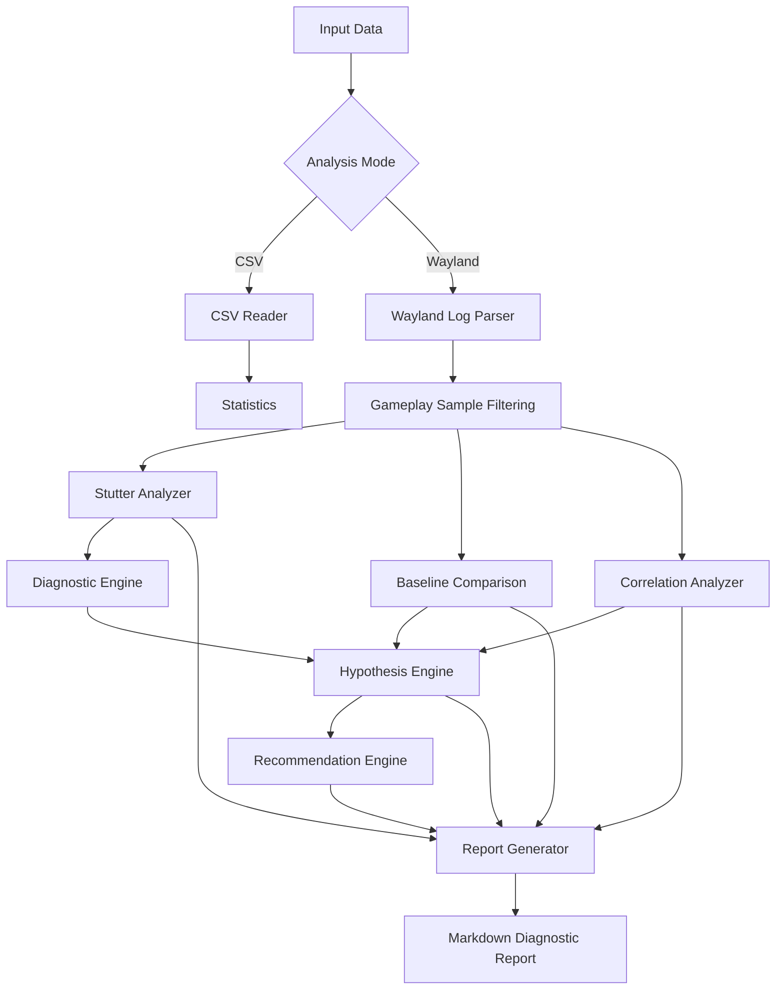

# DroidDeck Graphics Profiler — Architecture

## 1. Overview

DroidDeck Graphics Profiler is a modular C++17 application designed to analyze frame-time measurements and Wayland/Gamescope telemetry.

The architecture separates data ingestion, parsing, anomaly detection, diagnostic reasoning, and report generation into independent components.

The main execution paths are:

1. Frame-time CSV analysis.
2. Wayland/Gamescope telemetry analysis.

## 2. High-Level Data Flow



## 3. Core Components

### 3.1 CSV Reader

**Files:**
- `include/csv_reader.hpp`
- `src/csv_reader.cpp`

Responsible for reading frame-time measurements from CSV files.

Responsibilities:
- Load frame-time records.
- Validate numeric values.
- Skip malformed input rows.
- Provide parsed measurements to the statistics module.

### 3.2 Statistics Module

**Files:**
- `include/statistics.hpp`
- `src/statistics.cpp`

Calculates basic frame-time statistics.

Responsibilities:
- Average frame time.
- Maximum frame time.
- Estimated average FPS.
- Stutter counts based on a configurable threshold.

### 3.3 Wayland Log Parser

**Files:**
- `include/wayland_log_parser.h`
- `include/wayland_parser.h`
- `include/wayland_sample.h`

Extracts performance and presentation information from Wayland/Gamescope telemetry.

Responsibilities:
- Parse statistics and performance records.
- Match records using timestamps.
- Retain supported statistics-only samples.
- Track presentation-surface lifecycle events.
- Handle malformed and incomplete records.

The parser produces structured samples containing FPS, frame counts, timing measurements, and lifecycle information.

### 3.4 Stutter Analyzer

**Files:**
- `include/stutter_analyzer.hpp`
- `src/stutter_analyzer.cpp`

Analyzes gameplay telemetry to identify performance anomalies.

Responsibilities:
- Filter inactive and non-gameplay samples.
- Detect low-FPS intervals.
- Identify timing anomalies.
- Classify detected events by severity.
- Preserve the measurements and reasons associated with each event.

### 3.5 Diagnostic Engine

**Files:**
- `include/diagnostic_engine.hpp`
- `src/diagnostic_engine.cpp`

Classifies detected anomalies into diagnostic categories.

The categories include:
- FPS degradation.
- Timing anomaly.
- Combined anomaly.

The engine organizes observed symptoms without assuming that temporal correlation proves causation.

### 3.6 Baseline Comparison

**Files:**
- `include/baseline_comparison.hpp`
- `src/baseline_comparison.cpp`

Compares critical-FPS intervals against higher-FPS gameplay intervals.

Metrics include:
- Average FPS.
- Minimum and maximum FPS.
- Render Scene timing.
- Acquire timing.
- Present timing.
- Fence Wait timing.
- Release timing.
- Held-frame ratio.

This comparison helps identify differences between degraded and relatively stable gameplay conditions.

### 3.7 Correlation Analyzer

**Files:**
- `include/correlation_analyzer.hpp`
- `src/correlation_analyzer.cpp`

Calculates Pearson correlation coefficients between FPS and selected telemetry metrics.

Analyzed relationships include:
- FPS versus GPU frames from games.
- FPS versus frames on screen.
- FPS versus held-frame ratio.
- FPS versus GPU release waits.

Undefined correlations are represented when insufficient observations or zero variance prevent meaningful calculation.

### 3.8 Hypothesis Engine

**Files:**
- `include/hypothesis_engine.hpp`
- `src/hypothesis_engine.cpp`

Generates diagnostic hypotheses from observed telemetry and analysis results.

Investigated categories:
- Frame production degradation.
- Release timing bottleneck.
- Presentation lifecycle interference.
- Render bottleneck.
- Synchronization bottleneck.

Each hypothesis contains:
- Explanation.
- Supporting evidence.
- Contradictory evidence.
- Evidence score.
- Heuristic confidence level.

Evidence scores are investigative heuristics, not probabilities.

### 3.9 Recommendation Engine

**Files:**
- `include/recommendation_engine.hpp`
- `src/recommendation_engine.cpp`

Converts diagnostic hypotheses into actionable investigation plans.

Each recommendation includes:
- Related hypothesis.
- Priority.
- Rationale.
- Investigation steps.
- Validation experiments.

Recommendations describe experiments and further investigation rather than claiming that a suspected bottleneck has been confirmed.

### 3.10 Report Generator

**Files:**
- `include/report_generator.hpp`
- `src/report_generator.cpp`

Generates a structured Markdown report from the outputs of the analysis modules.

The report contains:
- Executive summary.
- Performance overview.
- FPS group comparison.
- Baseline comparison.
- Correlation analysis.
- Diagnostic hypotheses.
- Investigation recommendations.
- Detected stutter events.
- Limitations and interpretation.

Output:

`reports/wayland_diagnostic_report.md`

## 4. Execution Workflow

### Frame-Time Mode

```text
data/frame_times.csv
        |
        v
    CSV Reader
        |
        v
    Statistics
        |
        v
    Console Results
```

### Wayland Diagnostic Mode

```text
data/wayland.log
        |
        v
  Wayland Log Parser
        |
        v
 Gameplay Sample Filtering
        |
        v
    Stutter Analyzer
        |
        +----------------------+
        |                      |
        v                      v
 Diagnostic Engine      Baseline Comparison
        |                      |
        |                Correlation Analyzer
        |                      |
        +----------+-----------+
                   |
                   v
             Hypothesis Engine
                   |
                   v
           Recommendation Engine
                   |
                   v
             Report Generator
                   |
                   v
       Markdown Diagnostic Report
```

## 5. Testing Strategy

The project uses CTest to execute independent test suites.

The current test coverage includes:

- Statistics calculations.
- Wayland CSV parsing.
- Wayland log parsing.
- Stutter analysis.
- Diagnostic classification.
- Baseline comparison.
- Correlation analysis.
- Hypothesis generation.
- Recommendation generation.
- Markdown report generation.

The latest validation completed successfully with all 10 test suites passing.

## 6. Design Considerations

### Modular Design

Each major analysis responsibility is separated into its own module, making components easier to test and maintain.

### Evidence-Based Diagnostics

The system distinguishes measured observations from possible explanations.

### Defensive Parsing

Malformed and incomplete input records are handled without assuming that every telemetry record is valid.

### Reproducibility

Analysis operates on supplied datasets, allowing repeated execution and comparison of results.

### Explicit Limitations

The system does not directly instrument GPU execution or establish definitive root causes from correlation alone.

## 7. Future Improvements

Potential extensions include:

- Per-frame telemetry collection.
- Independent CPU submission and GPU completion measurements.
- Frame-time percentile analysis.
- Repeated-session comparison.
- More detailed lifecycle-event correlation.
- Structured JSON report output.
- Additional diagnostic validation experiments.